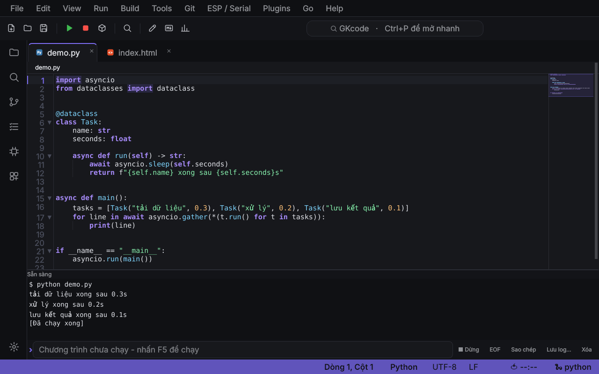
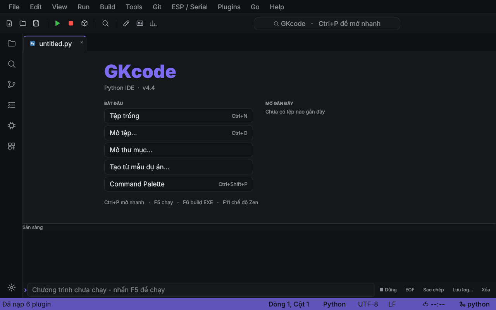
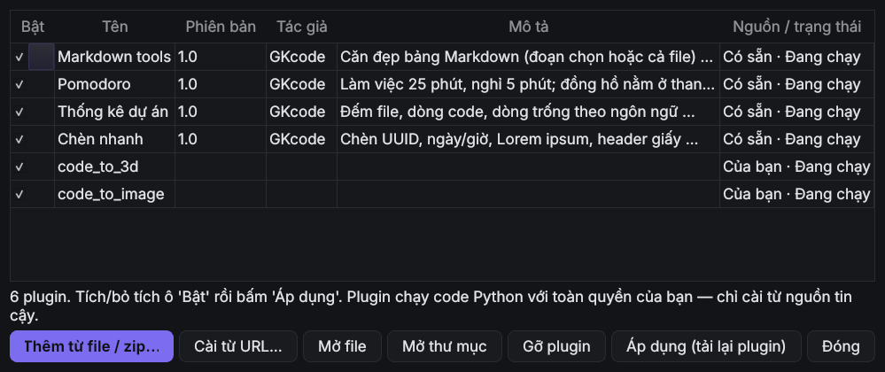
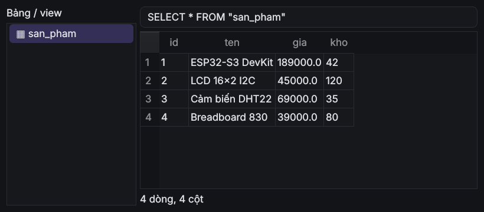

<div align="center">


# GKcode

**IDE gọn nhẹ viết bằng Python + PyQt5, giao diện tiếng Việt.**
Soạn code, chạy, build EXE, lập trình ESP/Arduino, xem ảnh · 3D · hex · media, mở rộng bằng plugin. Tất cả trong một cửa sổ.




</div>

---

## ✨ Tính năng

| | |
|---|---|
| **Soạn code** | Tô màu cú pháp hơn 40 ngôn ngữ (~100 đuôi file), minimap, gập code, Ctrl+P mở nhanh, Command Palette, tìm trong thư mục, đa tab, chế độ Zen |
| **Chạy & build** | F5 chạy Python · C/C++ · C# · Go · Java · JS/TS · Rust · PHP · Ruby · Lua…, F6 build `.exe` bằng PyInstaller |
| **ESP / Arduino** | Nạp firmware (esptool), Serial Monitor, Serial Plotter, mẫu dự án |
| **Trình xem tích hợp** | Ảnh, mô hình 3D (glb/gltf/obj/stl/ply/fbx), Hex, PyTorch `.pt`, SQLite, kho nén zip/tar, font, video/audio |
| **Dựng nhanh** | Cắt / ghép video bằng ffmpeg ngay trong IDE |
| **Công cụ** | Git, JSON/Regex, TODO, Markdown preview, đổi kiểu đặt tên, đổi tên symbol, thống kê tài liệu |
| **Plugin** | API Python đầy đủ, trình quản lý plugin, 4 plugin có sẵn |
| **File lớn** | File hàng chục MB mở mượt (đọc nền, nạp từng đợt, tự tắt tô màu), terminal không đơ khi in hàng trăm nghìn dòng |

<div align="center">



</div>

## 🚀 Cài đặt & chạy

Cần **Python 3.10+** và **PyQt5**.

```bash
git clone https://github.com/tkhoi0821-svg/GKcode.git
cd GKcode
pip install -r requirements.txt
python main.py
```

<details>
<summary><b>Windows</b></summary>

```bat
pip install -r requirements.txt
python main.py
```
Tạo lối tắt ngoài Desktop: bấm đúp `install_windows.bat`.
</details>

<details>
<summary><b>Linux (Fedora, Ubuntu, Arch…)</b></summary>

```bash
pip install --user PyQt5        # hoặc: sudo dnf install python3-qt5 / sudo apt install python3-pyqt5
python3 main.py
./install_linux.sh              # thêm GKcode vào menu ứng dụng (gỡ: ./install_linux.sh --remove)
```
- Trên Wayland (KDE/GNOME), `main.py` tự dùng `QT_QPA_PLATFORM=wayland;xcb`. Nếu giao diện hiện **trống/vỡ** với PyQt5 cài bằng pip, thử:
  `QT_QPA_PLATFORM=xcb QT_X11_NO_MITSHM=1 python3 main.py`.
- Nạp board ESP/Arduino cần quyền cổng serial: `sudo usermod -aG dialout $USER` rồi đăng nhập lại.
- Thiếu thư viện Qt (`xcb`): `sudo dnf install xcb-util-cursor` (Fedora) hoặc `sudo apt install libxcb-cursor0` (Ubuntu).
</details>

<details>
<summary><b>macOS</b></summary>

```bash
pip3 install PyQt5
python3 main.py
```
macOS chưa được kiểm thử nhiều, nếu gặp lỗi mở một issue giúp mình nhé.
</details>

**Tuỳ chọn:** `pip install pyflakes black pyinstaller PyQtWebEngine`. Lần lượt dùng cho kiểm lỗi, định dạng code, build EXE, trình duyệt/panel web.
Muốn chạy C/C++/C#/Rust… thì cài trình biên dịch tương ứng (`gcc`, `dotnet`, `rustc`…); thiếu thì GKcode báo rõ chứ không treo.

## ⌨️ Phím tắt chính

| Phím | Việc | Phím | Việc |
|---|---|---|---|
| `F5` | Chạy file | `Ctrl+P` | Mở nhanh file |
| `F6` | Build EXE | `Ctrl+Shift+P` | Command Palette |
| `F11` | Chế độ Zen | `Ctrl+R` | Đi tới hàm / class |
| `Ctrl+N / O / S` | Mới / Mở / Lưu | `Ctrl+Shift+F` | Tìm trong thư mục |
| `Ctrl+Alt+J` | Chọn lần xuất hiện kế tiếp | `Ctrl+Alt+F2` | Đổi tên symbol |
| `Ctrl+Alt+M` | Xem trước Markdown | | |

## 🧩 Plugin

Mở **Plugins ▸ Quản lý plugin…** để bật/tắt, cài từ file `.py` / `.zip` / URL GitHub, hoặc gỡ.
Plugin có sẵn (thư mục [`plugins/`](plugins)): **Thống kê dự án**, **Pomodoro**, **Chèn nhanh** (UUID / ngày giờ / Lorem / MIT), **Markdown tools**.

Viết plugin của bạn, lưu vào `~/.pyapp/plugins/ten.py`:

```python
PLUGIN = {"name": "Xin chào", "version": "1.0", "author": "Bạn", "description": "Ví dụ ngắn"}


def register(api):
    def hoa():
        api.replace_selection(api.selection().upper())

    api.add_action("Chữ HOA đoạn chọn", hoa, shortcut="Ctrl+Alt+U")
    api.add_toolbar_button("Hi", lambda: api.message("Xin chào từ plugin!"))
    api.on("save", lambda ed: api.status(f"Đã lưu {ed.file_path}"))
```

Xem đầy đủ API trong app: **Help ▸ Tài liệu API plugin**. Mọi plugin nhập vào đều được kiểm API (bằng `ast`, không chạy code) trước khi cho nạp.
> ⚠️ Plugin chạy Python với toàn quyền của bạn, chỉ cài từ nguồn tin cậy.

## 📦 Build file chạy (.exe / binary)

```bash
pip install pyinstaller
pyinstaller --noconfirm --windowed --name GKcode --icon icon.ico \
            --collect-submodules gkcode --add-data "icon.png:." main.py   # Windows dùng ";" thay cho ":"
cp -r plugins dist/GKcode/plugins
```
Hoặc tạo tag `v4.4` và push, workflow [`release.yml`](.github/workflows/release.yml) tự build cho Windows / Linux / macOS và đính kèm vào **Releases**.
PyInstaller không build chéo hệ điều hành, mỗi bản được build trên đúng hệ của nó.

## 🗂️ Cấu trúc

```
main.py            điểm khởi chạy
plugins/           plugin có sẵn (+ manifest.json)
docs/              ảnh chụp màn hình
gkcode/
  common.py        import chung, APP_VERSION, CFG
  core.py          tiện ích, bảng ngôn ngữ, lệnh chạy/build
  theme.py         theme, QSS, icon SVG, huy hiệu file
  editor.py        highlighter, CodeEditor, nạp file lớn
  langs.py         ngôn ngữ bổ sung (C#, TS, Rust, CSS, HTML…)
  filetypes.py     thêm ngôn ngữ/tệp, trình mở zip · SQLite · font
  terminal.py      terminal (output đệm)
  nettools.py      tải URL, git clone, thư mục plugin
  esp.py           ESP / Arduino, Serial Monitor/Plotter
  templates.py     mẫu dự án, Python console
  polyglot.py      chạy đa ngôn ngữ, Code → Ảnh / 3D
  plugins.py       PyAppAPI (API plugin)
  pluginmgr.py     Quản lý plugin
  textools.py      JSON, Regex, TODO, Git, REPL
  toolsmixin.py    menu công cụ, nạp plugin
  viewers.py       trình xem ảnh · 3D · hex · torch
  media.py         trình phát, Dựng nhanh (ffmpeg)
  prefs.py         Cài đặt
  extras.py        outline, Markdown, cập nhật…
  app.py           cửa sổ chính PyApp
```

## ❓ Hỏi nhanh

- **Mở file nặng có đơ không?** File > 2 MB đọc ở luồng nền; > 6 MB tự tắt tô màu/minimap/lint. Dòng dài hơn 100.000 ký tự được cắt khi hiển thị và mở **chỉ-đọc** (không cho lưu đè để khỏi mất dữ liệu).
- **Cài đặt lưu ở đâu?** QSettings (`PyAppTools/PyApp`); plugin của bạn ở `~/.pyapp/plugins/`.
- **Kiểm tra cập nhật?** Help ▸ Kiểm tra cập nhật.

## 🤝 Đóng góp

Issue và PR luôn được chào đón: [báo lỗi / góp ý](https://github.com/tkhoi0821-svg/GKcode/issues/new). Lịch sử thay đổi xem [CHANGELOG.md](CHANGELOG.md).
